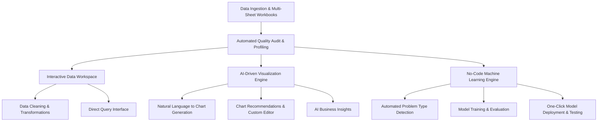
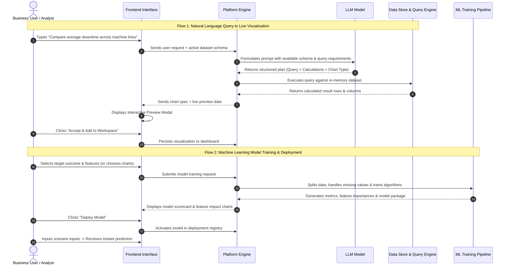

# Enterprise AI Analytics & Machine Learning Platform
## Product Capabilities, System Architecture, and Workflow Guide

---

## 1. Executive Summary

This application is an end-to-end **AI-Powered Business Intelligence and Machine Learning Platform**. It enables business users, data analysts, and decision-makers to transform raw tabular data into actionable intelligence without requiring manual coding or advanced database expertise.

Through a unified interface, users can:
- **Ingest & Profile Data**: Upload single-sheet or multi-sheet datasets with automated data quality audits and statistical profiling.
- **Query & Transform via Natural Language**: Ask questions in plain English to automatically retrieve data, run calculations, and generate visualizations.
- **Explore & Edit Visualizations**: Review automated chart recommendations, build custom visual dashboards, and generate analytical text summaries.
- **Train & Deploy Machine Learning Models**: Automatically detect predictive objectives, train machine learning models, inspect performance metrics, and deploy models for real-time predictions.

---

## 2. Core Functional Modules

### 2.1. Data Ingestion & Quality Auditing
- **Multi-Format & Multi-Sheet Support**: Accepts standard spreadsheet and tabular file formats, including Excel workbooks containing multiple sheets.
- **Automated Schema & Quality Auditing**: Upon upload, the platform scans every column to identify:
  - Data classifications (numerical, categorical, temporal dates, boolean flags).
  - Missing or null cell percentages and duplicate rows.
  - Potential data quality warnings (e.g., high cardinality, missing values, skewness).
- **Automated Feature Derivation**: Identifies temporal fields (such as timestamps) and automatically derives seasonal groupings (year, month, day of week) to enrich subsequent analysis.
- **Workbook Sheet Switching**: Users can toggle between individual sheets with a single click, automatically updating the active preview and recommendations while keeping all sheets queryable.

---

### 2.2. Interactive Data Workspace & Transformations
- **Live Data Grid**: Fast preview of rows and columns with interactive column sorting and filtering.
- **No-Code Data Transformations**: Users can perform data cleaning and preparation steps directly:
  - Adding calculated columns using mathematical expressions.
  - Filling missing values using standard statistical methods (mean, median, mode, or fixed constants).
  - Renaming and dropping columns.
  - Filtering records based on custom criteria.
- **Multi-Table Querying**: Allows executing queries across a single sheet or joining multiple workbook sheets into unified views.
- **Data Export**: Cleaned and transformed datasets can be downloaded at any stage.

---

### 2.3. AI-Driven Visualizations & Natural Language Charting
- **Automated Chart Recommendations**: Automatically suggests multi-category visualizations based on the dataset structure:
  - *Single Variable*: Distributions, metric summary cards, and category share breakdowns.
  - *Bi-Variable*: Comparative bars, trend lines over time, and scatter correlation plots.
  - *Multi-Variable*: Stacked category distributions and multi-metric comparisons.
- **Natural Language Chart Generator ("Chat with Data")**:
  - Located prominently at the top of the workspace.
  - Users type plain English requests (e.g., *"Compare manufacturing cost and output volume across plants"* or *"Show monthly defect trends"*).
- **Interactive Preview Modal**:
  - Before any generated chart is added to the workspace, an interactive preview modal appears.
  - Displays the live rendered chart, the transformation steps performed, the underlying retrieval logic, and a preview table of the actual data rows.
  - The user reviews the output and chooses to either accept it into their workspace or discard it.
- **AI Analytical Insights**: Users can click to generate automated business narratives that explain the trends, anomalies, and key takeaways shown in any chart.

---

### 2.4. Machine Learning & Predictive Modeling
- **Automated Objective Detection**:
  - Users select a column they want to predict or analyze.
  - The system automatically determines whether the goal is **Classification** (predicting a category), **Regression** (predicting a numerical amount), or **Clustering** (grouping similar records).
- **Visualization-to-Model Feature Selection**:
  - Users can select one or more charts from their visual workspace, and the system automatically extracts the relevant columns to populate the model's feature set.
- **Model Training & Evaluation**:
  - Trains appropriate machine learning algorithms on historical records.
  - Evaluates models using standard validation splits and provides comprehensive diagnostic metrics (accuracy, error rates, precision, recall, and feature importance rankings).
- **Model Deployment & Interactive Testing**:
  - Trained models can be registered and deployed with a single click.
  - Provides a simulation interface where users can enter hypothetical values for variables to instantly receive predictive outcomes.

---

## 3. End-to-End Architecture & Processing Flows

### 3.1. How Natural Language Queries Retrieve Data (Query-to-Data Pipeline)

1. **Schema Contextualization**:
   When a user submits a natural language question, the platform packages the question alongside the dataset’s structural metadata (column names, recognized data types, distinct value counts, and available sheet names).

2. **LLM Translation & Chart Selection**:
   The LLM model interprets the user's intent and performs three key tasks:
   - Formulates the exact retrieval query to extract and aggregate the necessary numbers.
   - Summarizes the mathematical calculation steps (such as groupings, sum/averaging functions, and filters).
   - Selects the optimal chart presentation (bar chart, line trend, scatter plot, pie composition, or metric summary).

3. **Secure In-Memory Query Execution**:
   The platform takes the formulated query and executes it against an isolated in-memory data engine. The engine processes the aggregations directly against the active sheet and any joined workbook sheets.

4. **Interactive Verification & User Approval**:
   Instead of immediately modifying the dashboard, the platform opens a **Preview Modal**. The user verifies that the chart, numbers, and calculation explanation match their expectations. Upon clicking **Accept**, the visualization is saved into the project workspace and organized under the appropriate visual category.

---

### 3.2. How Machine Learning Models Are Trained and Deployed

1. **Problem Formulation**:
   The user selects a target variable (for example, *machine downtime* or *customer churn*). The platform assesses the target column's distribution to automatically set the problem type (e.g., continuous numeric vs. discrete classes).

2. **Feature Preparation & Preprocessing**:
   The user selects predictive columns, or selects visual charts from which the platform automatically extracts columns. The training pipeline cleans missing data, applies statistical scaling to numerical inputs, and encodes categorical text values into mathematical representations.

3. **Algorithm Training & Validation**:
   The dataset is split into training and evaluation sets. The engine trains machine learning algorithms to uncover correlations and patterns. It assesses performance on unseen test data to calculate evaluation scores and measure which variables most strongly influence the outcome (feature importance).

4. **One-Click Deployment & Scenario Testing**:
   Once satisfied with the model's accuracy, the user can deploy it into the live registry. The deployed model becomes accessible through an interactive testing view, allowing team members to adjust scenario inputs and receive immediate predictions.

---

## 4. Summary of Key User Benefits

| Capability | Traditional Approach | Platform Approach |
| :--- | :--- | :--- |
| **Data Ingestion** | Requires manual database loading and script setup | Drag-and-drop CSV or multi-sheet Excel with instant profiling |
| **Data Exploration** | Writing complex manual queries or pivot tables | Natural language questions automatically translated into queries |
| **Chart Creation** | Manual visual configuration step-by-step | Automated recommendations and natural language chart generation |
| **Validation** | Trial-and-error visual creation | Interactive preview modal showing chart, query, and raw data before accepting |
| **Predictive Modeling** | Requiring specialized data science tools and code | Automated problem detection, visual training, and one-click deployment |
